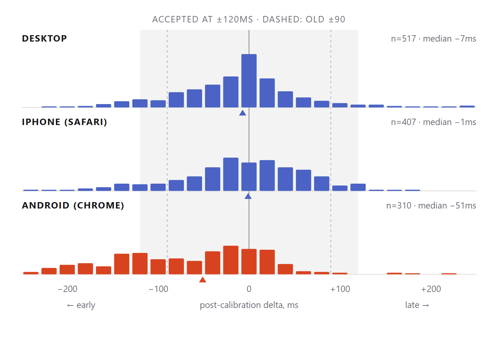

# Server-Certified Rhythm Performance Scoring

**OneDrum white paper · v1.0 · August 2026 · [canonical version](https://onedrum.io/whitepaper)**

How OneDrum certifies human timing on consumer devices whose clocks lie — the audible
clock, calibration with no calibration step, drift tracking, an anti-spoof gate that
calibration cannot blind, and a score anyone can verify. Every claim here is running in
production at [onedrum.io](https://onedrum.io) and backed by the field data shown.

## 1. The problem

Between a physical tap and the timestamp software sees, device-dependent delays
accumulate: touch input latency (30–100 ms), audio output latency (~30 ms wired,
150–300 ms on Bluetooth), and main-thread dispatch lag (measured: median 0.6 ms, worst
10.6 ms). A player tapping in perfect time with what they *hear* is recorded late by the
sum — often more than any reasonable acceptance window.

And when the score matters beyond entertainment, a second problem appears: the judgment
must be computed by a server from inputs a dishonest client could script, and any latency
compensation must not become a laundering channel that re-centres a bot's metronomic input
into apparently human timing. Rhythm games solve the first problem with explicit
calibration screens and ignore the second. OneDrum's design constraint was to solve both,
with zero ceremony.

## 2. Architecture: the client renders, the server decides

Every timestamp — cues, taps, replayed players — lives on the **media timeline**: the
reference clip's own playback time. No wall-clock synchronization between devices is ever
needed. The client transmits only tap timestamps; an isolated per-session server authority
computes calibration, acceptance, and plausibility with a pure, unit-tested scoring
kernel, and issues the result as a signed payload that records the acceptance window in
force for that run ([verification spec](https://onedrum.io/blog/verifying-certified-scores)).

```
physical tap ──► input-event timestamp ─┐
                                        ├──► client: media-timeline timestamps only
audio subsystem correlation ──► audible ┘            │
                                clock                ▼
                              per-session server authority
                          calibration · acceptance · plausibility
                                        │
                                        ▼
                        signed certified payload
                     (records acceptance window in force)
```

## 3. The audible clock

`AudioContext.currentTime` is a *scheduling* clock — when a sample was handed to the audio
system, not when it left the speaker. The gap is `baseLatency + outputLatency`: enough on
Bluetooth to exceed an entire acceptance window. OneDrum scores against **audible time**,
derived from the audio subsystem's own reported correlation between an emitted sample and
a high-resolution timestamp:

```
audibleTime(perfMs) = contextTime + (perfMs − performanceTime) / 1000
```

so cue time and tap time share one frame of reference regardless of output latency. Taps
are stamped from the input event's own timestamp (`event.timeStamp`), not from whenever
the handler ran — removing up to 10 ms of pure fake lateness.

## 4. Calibration with no calibration step

There is no calibration screen and no count-in. The music starts; the first bar is a
designated **warm-up**, presented identically to every other bar. The player answers it as
normal play, and that answer's raw delta becomes the device offset — subtracted from every
scored tap thereafter. The warm-up never counts toward the score. One answer suffices,
because the acceptance window (±120 ms) is wider than tap-to-tap human jitter (~25 ms):
one sample's imprecision is absorbed by the window's margin. Calibration is a side effect
of playing.

A player who fumbles the warm-up is caught by the **adaptive fallback**: while
uncalibrated, near-misses within ±200 ms are collected, and once at least 5 agree tightly
(σ ≤ 75 ms over *all* collected samples) and the median is device-plausible (≤ 180 ms),
the median is adopted and the current tap re-scored — so the tap that completes
calibration can itself certify. The guards are load-bearing: the magnitude cap sits below
a musical subdivision, so a consistent half-beat error is a musical mistake, never
"corrected" into a pass; the dispersion gate means scattered timing never locks in an
offset.

## 5. Drift: calibration that stays calibrated

Production data (§7) showed that on at least one major platform the reported audio latency
*drifts during a session* — an offset correct at the warm-up bar is stale bars later. The
design answer is drift re-centring: after calibration, the server watches a sliding window
of recent deltas; when the windowed median walks away from zero while dispersion stays
tight — the signature of a drifting clock, not a changing performance — the offset is
nudged toward the median under the same guards. The anti-spoof gate (§6) is computed on
values invariant to this correction, so drift tracking never weakens it.

## 6. Anti-spoof that calibration cannot blind

A run whose timing is tighter than human jitter allows (σ < 3 ms over 8+ taps) is flagged
`too_perfect`: denied a share card, denied replay into the crowd, and reported as
`trusted: false` in the certified payload — reported, not hidden. The subtle point is
*where* that test runs. Adaptive calibration re-centres a constant-offset stream — which
would hide a constant-offset replay bot from any test computed on post-calibration values.
So plausibility is computed on **raw** tap-minus-cue values, invariant to any constant
offset and stored separately from the scoring deltas. A machine replaying taps at a fixed
offset stays flagged even after calibration has politely centred its score.

## 7. Tuned by the field, not by vibes

The acceptance window began at ±90 ms with a written commitment: tune from logged deltas.
1,234 genuine production attempts later, the data spoke — desktop and iPhone centred
within 7 ms of zero; Android sat 51 ms early with misses running 119 early to 6 late, the
drift signature that motivated §5. The window is now ±120 ms — one sixteenth note at
120 BPM — and every certified payload records the window it was judged under, so tuning
never creates ambiguity about historical scores.
Full analysis: [the field note](https://onedrum.io/blog/why-android-drums-early).



## 8. The circle: a verification-gated crowd

Every completed run that certifies at least half its cues *and* passes the plausibility
gate is stored and replayed — in media time, so registration is perfect — into later
sessions. A solo visitor plays inside a circle immediately, and that circle is a curated
cohort: every replayed player was certified and judged plausibly human. Honesty labeling
is part of the mechanism: recorded players are marked as replayed, never passed off as
live, and any operator-seeded streams are stored with a synthetic marker, labeled
distinctly, and ranked behind real runs. A prospective synchronized start extends the
circle across devices with a single relative countdown — never a compared clock — while
certification stays media-relative and clock-free.

## 9. Beyond the beat: where the kernel generalizes

The certified kernel is game-agnostic; these directions are disclosed in the filings and
on the roadmap. **Trading fours:** alternating bounded call-and-response exchanges at
invariant tempo — against an automated leader or another player — each response certified
per exchange; the tempo never adapts, so keeping time is itself the discipline.
**Precision timers:** server-issued signed targets (no offline grinding), scores measured
as intervals between a player's own inputs so device latency cancels without any
calibration, and humanity judged statistically across attempt history. **Acoustic
technique:** microphone-captured real drumming, onsets feeding the same timing
certification, with a machine-learned model scoring technique dimensions beyond timing —
composed into the same signed result.

## Appendix: parameters as implemented

| Parameter | Value | Role |
|---|---|---|
| Acceptance half-window | ±120 ms | certify if \|calibrated delta\| ≤ this (±90 ms until the 2026-08-13 retune) |
| Warm-up / adaptive capture bound | ±200 ms | beyond this, a miss — not a calibration sample |
| Adopted-offset magnitude cap | ±180 ms | offsets beyond this are not adopted (not a device) |
| Adaptive minimum samples | 5 | before adoption from play |
| Adaptive tightness bound | σ ≤ 75 ms | scattered timing never adopts an offset |
| Minimum inter-tap interval | 250 ms | rate limit, keyed to wall clock (anti-spoof) |
| Too-perfect threshold | σ < 3 ms over ≥ 8 taps | machine flag, computed on raw residuals |

All parameters are single-point configuration constants tuned from logged real-device
data; the values are the working set, not claimed optima.

---

**Patent pending.** The mechanisms described here are the subject of U.S. Provisional
Patent Applications No. 64/089,862 (filed June 13, 2026) and No. 64/134,723 (filed
August 15, 2026). No license, express or implied, is granted by this publication —
see the [terms](https://onedrum.io/terms).

*OneDrum is the engine and the API; Viking Row is the first experience built on it.
Questions from operators are welcome.*
